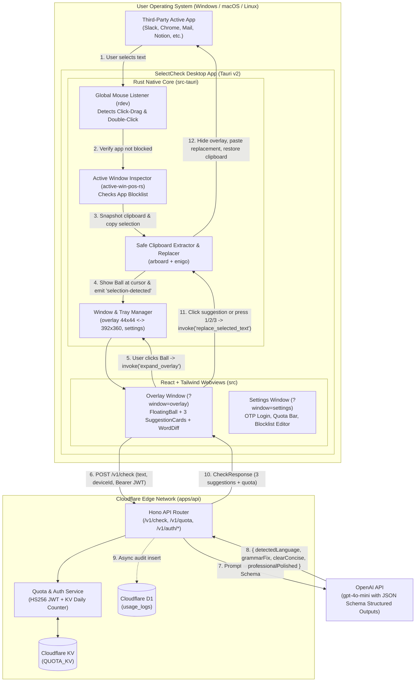
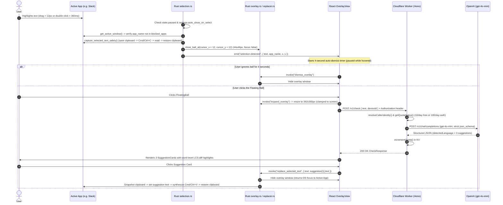
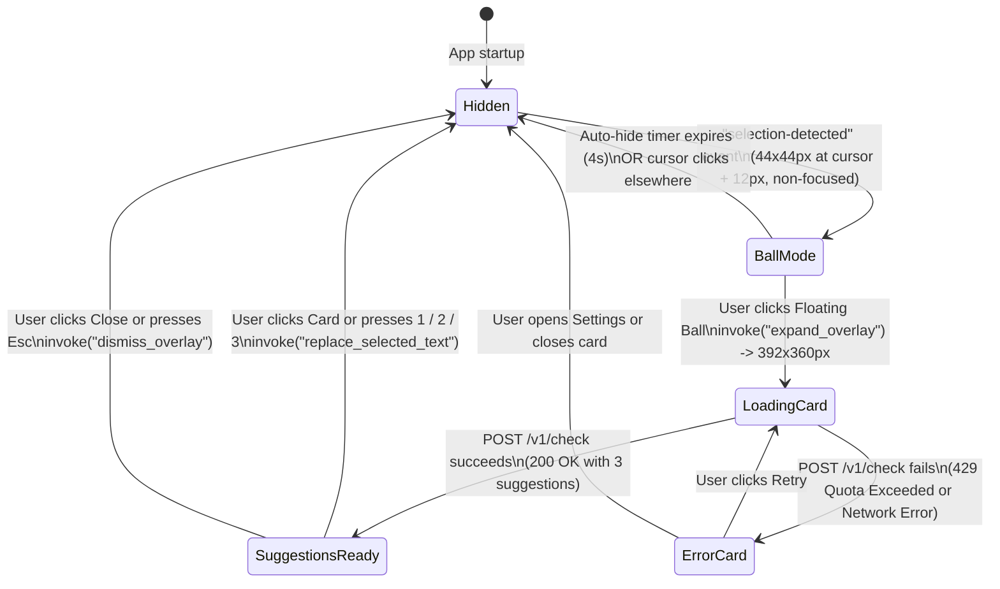

# 01. Architecture Overview

This document explains how **SelectCheck** is structured across the monorepo, how its components interact at runtime, and how data flows from an OS mouse gesture to an OpenAI grammar check and back into the active application.

---

## 1. Monorepo Structure

SelectCheck uses **pnpm workspaces** (`pnpm-workspace.yaml`) to share strict TypeScript contracts between the desktop client and the serverless edge backend:

```text
select-check/
├── package.json                 # Root scripts (dev:api, dev:desktop, tauri:dev, test, build)
├── pnpm-workspace.yaml          # Workspace definition (packages/*, apps/*)
├── tsconfig.base.json           # Shared strict TypeScript configuration (ES2022, bundler)
├── docs/                        # Complete technical knowledge base & ADRs
├── packages/
│   └── shared/                  # @select-check/shared — Shared types, API contracts, constants
│       └── src/index.ts
└── apps/
    ├── api/                     # @select-check/api — Cloudflare Workers + Hono edge backend
    │   ├── wrangler.toml        # Cloudflare KV, D1, and environment bindings
    │   ├── schema.sql           # D1 SQLite schema (users, usage_logs)
    │   ├── src/
    │   │   ├── index.ts         # Hono app router & CORS middleware
    │   │   ├── dev-server.ts    # Local Node HTTP server wrapper (@hono/node-server)
    │   │   ├── types.ts         # CloudflareBindings interface
    │   │   ├── routes/
    │   │   │   ├── check.ts     # POST /v1/check & GET /v1/quota
    │   │   │   └── auth.ts      # POST /v1/auth/otp & POST /v1/auth/verify
    │   │   └── services/
    │   │       ├── openai.ts    # OpenAI Structured Outputs + local heuristic fallback
    │   │       └── quota.ts     # JWT identity resolution + KV/memory daily counters
    │   └── test/
    │       └── api.test.ts      # Vitest integration tests for check, quota, and OTP auth
    └── desktop/                 # @select-check/desktop — Tauri v2 cross-platform app
        ├── src-tauri/           # Rust native OS layer
        │   ├── Cargo.toml       # Rust dependencies (tauri, rdev, arboard, enigo, active-win-pos-rs)
        │   ├── tauri.conf.json  # Multi-window config (overlay + settings) & bundle targets
        │   ├── capabilities/    # Tauri v2 fine-grained window permissions
        │   └── src/
        │       ├── main.rs      # Native binary entry point
        │       ├── lib.rs       # Shared state, settings commands, plugin initialization
        │       ├── selection.rs # Global mouse listener, blocklist check, safe text extraction
        │       ├── overlay.rs   # Window positioning, screen clamping, ball <-> card resize
        │       ├── replacer.rs  # Focus-safe in-place text replacement via clipboard/paste
        │       └── tray.rs      # OS system tray menu (Pause/Resume, Settings, Quit)
        ├── src/                 # React 19 + TypeScript + Tailwind CSS v4 frontend
        │   ├── App.tsx          # Window query-param router (?window=overlay | settings)
        │   ├── components/
        │   │   ├── FloatingBall.tsx
        │   │   └── SuggestionCard.tsx
        │   ├── views/
        │   │   ├── OverlayView.tsx
        │   │   ├── SettingsView.tsx
        │   │   └── InteractiveWorkspace.tsx
        │   ├── services/
        │   │   ├── api.ts
        │   │   └── tauriBridge.ts
        │   └── utils/
        │       └── diff.ts      # Word-level LCS diff algorithm
        └── test/
            └── diff.test.ts     # Unit tests for word-level diff segments
```

---

## 2. High-Level System Architecture



---

## 3. End-to-End Runtime Lifecycle (Sequence Diagram)



---

## 4. Overlay Window State Machine

The overlay window (`?window=overlay`) transitions through four well-defined states managed jointly by `OverlayView.tsx` and `overlay.rs`:



---

## 5. Shared Data Contract (`packages/shared/src/index.ts`)

Both `apps/api` and `apps/desktop` import `@select-check/shared` so request payloads, suggestion styles, and quota structures are guaranteed to stay in sync at compile time:

| Type / Constant | Purpose |
| :--- | :--- |
| `SuggestionStyle` | Union type: `'grammar_fix' \| 'clear_concise' \| 'professional_polished'` |
| `SuggestionItem` | `{ style, label, text, summary }` representing one of the 3 cards |
| `QuotaInfo` | `{ used, limit, tier: 'free_device' \| 'authenticated', resetsAt }` |
| `CheckRequest` | `{ text: string, deviceId: string }` sent to `POST /v1/check` |
| `CheckResponse` | `{ detectedLanguage, originalText, suggestions: [item1, item2, item3], quota }` |
| `AppSettings` | User preferences persisted locally and synced with the Rust core |
| `DEFAULT_BLOCKED_APPS` | Default ignore list (`Terminal`, `iTerm2`, `Warp`, `Alacritty`, `WindowsTerminal`, `cmd.exe`, `powershell.exe`) |
| `FREE_DEVICE_DAILY_LIMIT` | `10` checks per UTC day per anonymous `deviceId` |
| `AUTHENTICATED_DAILY_LIMIT` | `100` checks per UTC day per signed-in user |
