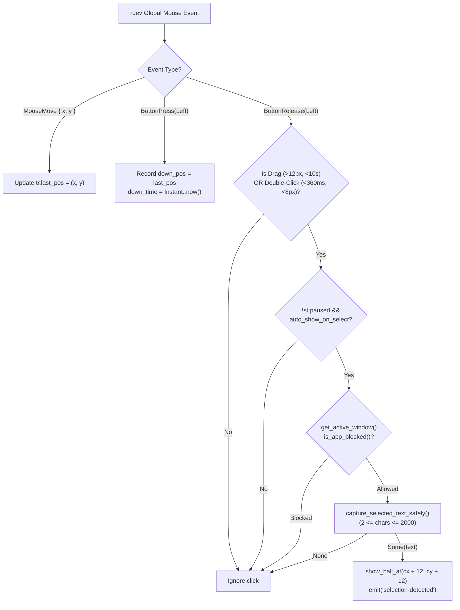

# 02. Desktop Native Core (`apps/desktop/src-tauri`)

This document explains the **Tauri v2 Rust backend** (`apps/desktop/src-tauri`) inch by inch: how it hooks into the OS mouse stream, filters out blocked applications, extracts selected text without destroying the user's clipboard, positions and resizes the transparent overlay window within monitor boundaries, and performs focus-safe in-place text replacement.

---

## 1. Crate Dependencies (`src-tauri/Cargo.toml`)

| Crate | Version | Role in SelectCheck |
| :--- | :--- | :--- |
| `tauri` | `2.1.0` | Core windowing, IPC command bridge, event emitter, `tray-icon`, and `macos-private-api` (for transparent frameless overlays on macOS). |
| `tauri-plugin-global-shortcut` | `2.0.0` | Registers system-wide keyboard shortcuts (`Cmd+Shift+G` / `Ctrl+Shift+G`). |
| `tauri-plugin-shell` | `2.0.0` | Allows opening external URLs or OS system settings panels. |
| `rdev` | `0.5.3` | Low-level cross-platform global mouse event listener (`MouseMove`, `ButtonPress`, `ButtonRelease`) across Windows, macOS, and Linux X11. |
| `active-win-pos-rs` | `0.8.4` | Queries the currently focused OS window to inspect `app_name` before triggering the floating ball. |
| `arboard` | `3.4.1` | Cross-platform OS clipboard reader/writer used to snapshot, read, and restore clipboard text. |
| `enigo` | `0.2.1` | Cross-platform keyboard synthesizer used to send `Cmd+C`/`Ctrl+C` (selection capture) and `Cmd+V`/`Ctrl+V` (in-place replacement). |

---

## 2. Multi-Window & Capability Configuration (`tauri.conf.json`)

SelectCheck defines two native webview windows in `apps/desktop/src-tauri/tauri.conf.json`:

1. **`overlay` Window (`?window=overlay`)**
   - `width: 44`, `height: 44` (initial Floating Ball dimensions)
   - `decorations: false`, `transparent: true`, `alwaysOnTop: true`, `skipTaskbar: true`, `visible: false`, `resizable: false`
   - **`focus: false`**: Critical setting so that when `win.show()` is called to display the Floating Ball next to the cursor, the OS **does not steal window focus** away from the user's active text editor.
2. **`settings` Window (`?window=settings`)**
   - `width: 620`, `height: 680`, `center: true`, `visible: false`
   - Opened on demand from the System Tray menu or by clicking the gear icon inside the overlay popover.

Fine-grained permissions (`core:window:allow-set-size`, `core:window:allow-set-position`, `core:window:allow-show`, `core:window:allow-hide`, `core:window:allow-set-focus`, `global-shortcut:allow-register`) are declared in `src-tauri/capabilities/default.json`.

---

## 3. Application State & IPC Commands (`src/lib.rs`)

`src/lib.rs` manages the thread-safe shared runtime state (`SharedState = Arc<Mutex<AppRuntimeState>>`):

```rust
pub struct AppRuntimeState {
    pub paused: bool,
    pub settings: DesktopSettings,
    pub last_selected_text: String,
    pub last_source_app: String,
    pub last_cursor: (f64, f64),
}
```

It exposes six Tauri IPC commands to the React frontend via `tauri::generate_handler!`:

| IPC Command | Module | Description |
| :--- | :--- | :--- |
| `expand_overlay` | `overlay.rs` | Resizes the `overlay` window from `44x44` (Ball) to `392x360` (Card), clamped to the active monitor bounds, and focuses the card for `1`/`2`/`3`/`Esc` hotkeys. |
| `dismiss_overlay` | `overlay.rs` | Hides the `overlay` window and resets its logical size back to `44x44`. |
| `open_settings_window` | `overlay.rs` | Shows and focuses the `settings` window. |
| `replace_selected_text` | `replacer.rs` | Hides the overlay, restores focus to the source editor, pastes the chosen suggestion in-place, and restores the prior clipboard. |
| `get_settings` | `lib.rs` | Returns the current `DesktopSettings` struct from `AppRuntimeState`. |
| `save_settings` | `lib.rs` | Updates `DesktopSettings` (including `auto_show_on_select`, `auto_hide_seconds`, and `blocked_apps`) in memory. |

---

## 4. Global Selection Detection (`src/selection.rs`)

### 4.1 Gesture Recognition (`MouseTracker`)
A dedicated background thread runs `rdev::listen` and tracks mouse state in `MouseTracker`:



- **Click-and-Drag Selection**: Triggered when the Euclidean distance between `ButtonPress(Left)` and `ButtonRelease(Left)` exceeds `12.0` pixels within `10` seconds:
  $$\text{distance} = \sqrt{(x_2 - x_1)^2 + (y_2 - y_1)^2} > 12.0$$
- **Double-Click Word Selection**: Triggered when two left-button releases occur within `360ms` and within `8.0` pixels of each other.

### 4.2 Blocklist Filtering (`is_app_blocked`)
Before attempting to read the selection, `get_active_window()` retrieves the active application's name. `is_app_blocked(app_name, blocked_apps)` performs a case-insensitive substring check:
- Always ignores `SelectCheck` itself (so clicking inside SelectCheck never recursively triggers the ball).
- Ignores any app matching an entry in `settings.blocked_apps` (such as `Terminal`, `iTerm2`, `Warp`, `WindowsTerminal`).

### 4.3 Non-Destructive Clipboard Selection Capture (`capture_selected_text_safely`)
Because third-party applications across Windows, macOS, and Linux use diverse UI toolkits (Cocoa, Win32, WPF, Electron/Chromium, GTK, Qt), reading selected text via a temporary clipboard transaction is the universal cross-application mechanism:

1. **Snapshot**: Reads and saves `previous_clipboard = clipboard.get_text().ok()`.
2. **Clear Sentinel**: Writes an empty string `""` to the clipboard so stale clipboard text is never mistaken for a new selection if the user dragged on empty space.
3. **Synthesize Copy**: Sends `Cmd+C` (`Key::Meta` + `'c'` on macOS) or `Ctrl+C` (`Key::Control` + `'c'` on Windows/Linux) via `enigo`.
4. **Wait & Read**: Sleeps `55ms` for the target application to populate the clipboard, then reads `captured = clipboard.get_text()`.
5. **Restore Original Clipboard**: Immediately writes `previous_clipboard` back to the OS clipboard so the user's copied data is untouched.
6. **Length Filter**: Returns `Some(text)` only if `2 <= text.chars().count() <= 2000`.

---

## 5. Window Positioning & Screen Clamping (`src/overlay.rs`)

To prevent the Floating Ball (`44x44`) or the expanded Popover Card (`392x360`) from rendering partially off-screen when a user selects text near the right or bottom edge of their monitor, `clamp_to_screen` clamps coordinates against the active monitor's logical dimensions:

```rust
pub fn clamp_to_screen(
    x: f64,
    y: f64,
    width: f64,
    height: f64,
    screen_w: f64,
    screen_h: f64,
) -> (f64, f64) {
    let clamped_x = x.max(12.0).min((screen_w - width - 12.0).max(12.0));
    let clamped_y = y.max(24.0).min((screen_h - height - 24.0).max(24.0));
    (clamped_x, clamped_y)
}
```

- **`show_ball_at(app, x, y)`**: Resizes `overlay` to `44x44`, positions it at `(x, y)` clamped to the monitor, and shows it without stealing focus.
- **`expand_overlay(app)`**: Reads the current `outer_position` of the ball, recalculates clamped coordinates for `392x360` so the expanded card stays inside the monitor bounds, resizes the window, and calls `win.set_focus()` so keyboard shortcuts (`1`, `2`, `3`, `Esc`) work immediately.

---

## 6. Focus-Safe In-Place Text Replacement (`src/replacer.rs`)

When the user clicks one of the 3 suggestion cards (or presses `1`, `2`, or `3`), the frontend calls `invoke("replace_selected_text", { text })`:

1. **Dismiss Overlay First**: Calls `dismiss_overlay_window(&app)` to hide the `overlay` window. Because the `overlay` window was the topmost transient window, hiding it causes the OS window manager (macOS WindowServer, Windows DWM, X11 WM) to immediately return active keyboard focus to the underlying application where the text remains highlighted.
2. **Focus Settle Delay**: Waits `65ms` for focus handoff to complete.
3. **Clipboard Swap & Paste**:
   - Saves `original_clipboard = clipboard.get_text().ok()`.
   - Sets the clipboard to the chosen suggestion `text`.
   - Synthesizes `Cmd+V` (macOS) or `Ctrl+V` (Windows/Linux) via `enigo`, which replaces the active selection in-place.
4. **Clipboard Restore**: Waits `90ms` for the target app to process the paste event, then restores `original_clipboard`.

---

## 7. System Tray Integration (`src/tray.rs`)

`setup_system_tray` registers a native OS menu bar / system tray icon (`select-check-tray`) with three actions:
- **Pause / Resume SelectCheck** (`toggle_pause`): Toggles `state.paused` and updates the menu label dynamically between `"Pause SelectCheck"` and `"Resume SelectCheck"`.
- **Settings & Quota...** (`open_settings`): Shows and focuses the `settings` window.
- **Quit SelectCheck** (`quit`): Cleanly exits the application (`app.exit(0)`).
