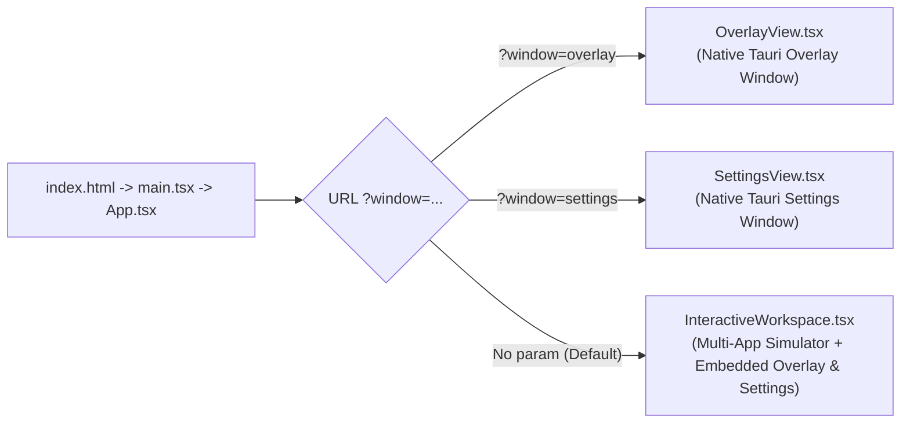
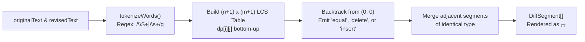

# 03. Desktop Frontend UI, Word-Diff Engine & Simulator (`apps/desktop/src`)

This document details the **React 19 + TypeScript + Tailwind CSS v4** frontend in `apps/desktop/src`, including multi-window routing, the dual Tauri/Browser bridge, the Floating Ball and Suggestion Cards, the Longest Common Subsequence (LCS) word-diff algorithm, and the interactive desktop simulator.

---

## 1. Frontend Architecture & Window Routing (`src/App.tsx`)

A single Vite bundle powers all views in SelectCheck. `src/App.tsx` inspects `window.location.search` (`?window=...`) to mount the appropriate view:

| Route | Mounted Component | When Used |
| :--- | :--- | :--- |
| `index.html?window=overlay` | `OverlayView` | Loaded by Tauri's transparent always-on-top `overlay` window. |
| `index.html?window=settings` | `SettingsView` | Loaded by Tauri's `settings` window when opened from the system tray or popover. |
| `index.html` (root) | `InteractiveWorkspace` | Loaded during browser/Vite development (`pnpm dev:desktop`) to simulate selecting text across Slack, Mail, and Terminal windows. |

---

## 2. Dual-Environment Tauri Bridge (`src/services/tauriBridge.ts`)

`tauriBridge.ts` abstracts all native Tauri v2 operations so the React components work identically inside both the native Rust webview and a standard web browser:

- **`isTauriEnvironment()`**: Checks `'__TAURI_INTERNALS__' in window`.
- **`getAppSettings()` & `saveAppSettings(next)`**: Persists settings in `localStorage` (`select_check_settings_v1`) for instant synchronous access and, when running inside Tauri, syncs them to the Rust `AppRuntimeState` via `invoke('get_settings')` and `invoke('save_settings')`.
- **`expandNativeOverlay()` / `dismissNativeOverlay()` / `openNativeSettingsWindow()`**: Invokes the corresponding Rust window commands when in Tauri, or no-ops cleanly in browser simulator mode.
- **`replaceSelectedTextInPlace(text)`**: Invokes `replace_selected_text` in Rust when running natively, while `OverlayView` also triggers the `onReplaceText` callback for the browser simulator.

---

## 3. Overlay View & Components (`OverlayView.tsx`, `FloatingBall.tsx`, `SuggestionCard.tsx`)

### 3.1 `FloatingBall.tsx` (`mode === 'ball'`)
- Renders a `36x36px` circular gradient button (`from-indigo-500 via-violet-500 to-fuchsia-500`) with a subtle ping animation and a `Sparkles` icon.
- **Auto-Hide Timer**: `OverlayView.tsx` starts a configurable countdown timer (`settings.autoHideSeconds`, default `4s`) whenever the ball appears.
- **Hover Pause**: Hovering the mouse over the ball sets `hoveringBall = true`, pausing the auto-hide timer so the ball never disappears while the user is about to click it.

### 3.2 `OverlayView.tsx` (`mode === 'card'`)
When the user clicks the Floating Ball:
1. Switches `mode` from `'ball'` to `'card'` and calls `expandNativeOverlay()`.
2. Calls `checkGrammarWithApi(selectedText, settings)` (`POST /v1/check`).
3. Renders the popover card header containing:
   - **Detected Language Badge** (e.g., `EN`, `ES`, `FR`).
   - **Daily Quota Pill** (e.g., `3/10 today` or `12/100 today`).
   - **Diff Toggle Button** (`Show/Hide Word Diff`).
   - **Settings Button** & **Close (`Esc`) Button**.
4. Listens for global keyboard shortcuts while the card is open:
   - Pressing `1`, `2`, or `3` immediately applies the corresponding suggestion in-place.
   - Pressing `Escape` dismisses the overlay.

### 3.3 `SuggestionCard.tsx`
Each of the 3 returned suggestions is rendered as an interactive card styled by its `SuggestionStyle`:

| Index / Hotkey | `style` | Label | Accent Theme | Purpose |
| :---: | :--- | :--- | :--- | :--- |
| **`1`** | `grammar_fix` | **Grammar Fix** | Emerald (`emerald-500`) | Fixes only grammar, spelling, and punctuation errors. |
| **`2`** | `clear_concise` | **Clear & Concise** | Sky (`sky-500`) | Rewrites for natural flow, clarity, and conciseness. |
| **`3`** | `professional_polished` | **Professional & Polished** | Violet (`violet-500`) | Elevates tone for professional or formal communication. |

- **Primary Action (Click Card / Press `Enter` / Press `1`/`2`/`3`)**: Replaces the selected text in-place in the active application.
- **Secondary Action (`Copy` Button)**: Calls `navigator.clipboard.writeText(item.text)` with `e.stopPropagation()` so the user can copy a suggestion without replacing the original text.

---

## 4. Word-Level LCS Diff Engine (`src/utils/diff.ts`)

To show users *exactly* which words were fixed or rewritten in each suggestion, `src/utils/diff.ts` implements a **Longest Common Subsequence (LCS)** diff algorithm operating on word and whitespace tokens.

### 4.1 Algorithm Step-by-Step

1. **Word + Whitespace Tokenization**:
   `text.match(/\S+|\s+/g)` splits strings into alternating word and whitespace tokens so natural spacing is preserved.
2. **Dynamic Programming Table ($O(N \cdot M)$)**:
   Builds a 2D matrix `dp` of size $(N + 1) \times (M + 1)$ where:
   $$dp[i][j] = \begin{cases} 1 + dp[i+1][j+1] & \text{if } a[i] = b[j] \\ \max(dp[i+1][j], dp[i][j+1]) & \text{otherwise} \end{cases}$$
3. **Backtracking & Contiguous Segment Merging**:
   Walks from $(0, 0)$ to $(N, M)$ to produce `'equal'`, `'delete'`, and `'insert'` tokens, then merges adjacent segments of the same type so multi-word deletions or insertions render as a single clean `<del>` or `<ins>` badge.

---

## 5. Settings & Quota Management (`src/views/SettingsView.tsx`)

`SettingsView.tsx` provides three tabs:
1. **Account & Quota Tab**:
   - Displays a visual progress bar of daily checks used (`used / limit`).
   - Implements passwordless **Email OTP sign-in** (`POST /v1/auth/otp` -> `POST /v1/auth/verify`). Once verified, stores the signed JWT in `settings.authToken` and upgrades the user from the `10/day` anonymous device tier to the `100/day` authenticated tier.
2. **Triggers & Blocklist Tab**:
   - Toggle automatic floating ball popup on text selection (`autoShowOnSelect`).
   - Configure the auto-hide countdown duration (`3s`, `4s`, `6s`, `8s`).
   - Add or remove application names from `blockedApps`.
3. **OS Permissions Tab**:
   - Explains clipboard preservation and platform-specific setup (macOS Accessibility permission, Windows Win32/UIAutomation, Linux X11/Wayland).

---

## 6. Interactive Desktop Simulator (`src/views/InteractiveWorkspace.tsx`)

When running `pnpm dev:desktop` in a browser (`http://localhost:5173`), `InteractiveWorkspace.tsx` renders a multi-app desktop sandbox with three simulated OS windows:
- **Slack** (pre-loaded with a casual message containing grammar mistakes)
- **Apple Mail / Outlook** (pre-loaded with a wordy business email)
- **Terminal** (included in the default **App Blocklist** so you can verify that selecting text inside a blocked app suppresses the floating ball)

Selecting any text inside the unblocked editors positions `OverlayView` right next to your mouse cursor, calls the live backend API (`http://localhost:8787/v1/check`), and replaces the highlighted substring directly inside the `<textarea>` when you pick a suggestion.
