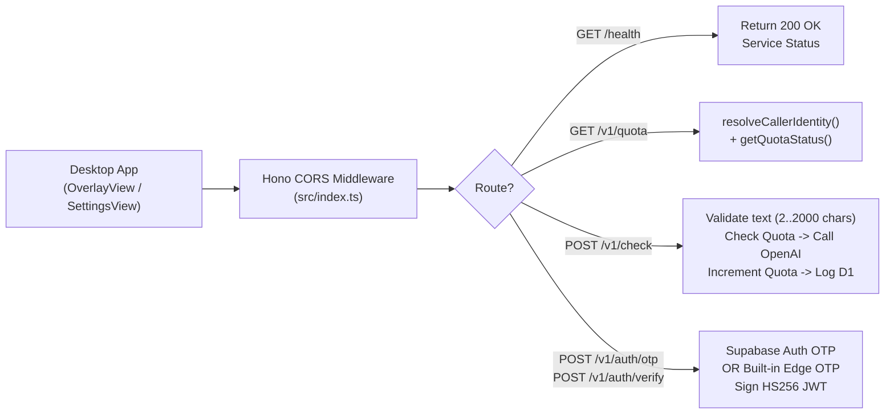
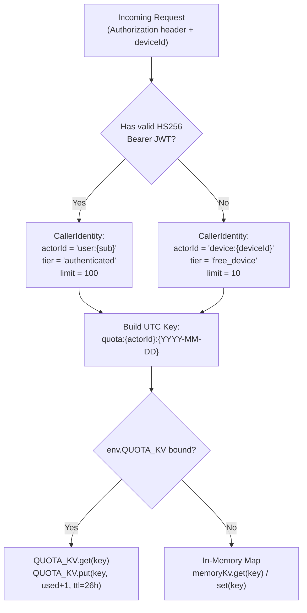

# 04. Serverless Edge API, Quotas & OpenAI Integration (`apps/api`)

This document explains the **Cloudflare Workers + Hono** backend (`apps/api`) inch by inch: its HTTP routes, OpenAI `gpt-4o-mini` Structured Outputs schema, deterministic local fallback, daily quota enforcement (`10/day` anonymous device vs `100/day` signed-in user), and passwordless Email OTP authentication.

---

## 1. Backend Architecture & Request Pipeline



### Environment Bindings (`src/types.ts` & `wrangler.toml`)

| Binding | Type | Required? | Purpose |
| :--- | :--- | :---: | :--- |
| `OPENAI_API_KEY` | Secret (`string`) | Optional in dev | OpenAI API secret key (`sk-...`). When unset, the API automatically uses `buildLocalHeuristicSuggestions()`. |
| `OPENAI_MODEL` | Variable (`string`) | Optional | Defaults to `"gpt-4o-mini"` for sub-second latency and low cost. |
| `JWT_SECRET` | Secret (`string`) | Optional in dev | HMAC-SHA256 secret used by `hono/jwt` to sign and verify user session tokens. |
| `QUOTA_KV` | `KVNamespace` | Optional in dev | Cloudflare KV namespace storing daily counters (`quota:{actorId}:{YYYY-MM-DD}`). Falls back to an in-memory `Map` in local dev/tests. |
| `DB` | `D1Database` | Optional | Cloudflare D1 SQLite database (`schema.sql`) recording non-blocking usage telemetry (`usage_logs`). |
| `SUPABASE_URL` / `SUPABASE_ANON_KEY` | Secret (`string`) | Optional | When provided, proxies `/v1/auth/otp` and `/v1/auth/verify` to Supabase Auth. |
| `FREE_DAILY_LIMIT` | Variable (`string`) | Optional | Defaults to `"10"` checks per UTC day per anonymous device. |
| `AUTH_DAILY_LIMIT` | Variable (`string`) | Optional | Defaults to `"100"` checks per UTC day per authenticated user. |

---

## 2. REST API Endpoint Reference

### 2.1 `GET /health`
Returns service readiness metadata.

- **Response (`200 OK`)**:
  ```json
  {
    "status": "ok",
    "service": "select-check-api",
    "timestamp": "2026-11-06T00:00:00.000Z"
  }
  ```

---

### 2.2 `GET /v1/quota`
Returns the caller's current daily usage and quota tier.

- **Headers**:
  - `X-Device-Id: <deviceId>`
  - `Authorization: Bearer <jwt>` *(optional)*
- **Response (`200 OK`)**:
  ```json
  {
    "quota": {
      "used": 3,
      "limit": 10,
      "tier": "free_device",
      "resetsAt": "2026-11-07T00:00:00.000Z"
    }
  }
  ```

---

### 2.3 `POST /v1/check`
Checks the selected text and returns the top 3 improvement suggestions along with updated quota metadata.

- **Headers**:
  - `Content-Type: application/json`
  - `X-Device-Id: <deviceId>`
  - `Authorization: Bearer <jwt>` *(optional)*
- **Request Body (`CheckRequest`)**:
  ```json
  {
    "text": "me and him goes to the store yesterday for buy milk",
    "deviceId": "dev_8f92a1b0"
  }
  ```
- **Validation Rules**:
  - `text.trim().length < 2` $\rightarrow$ `400 Bad Request`
  - `text.trim().length > 2000` $\rightarrow$ `400 Bad Request`
  - `quota.used >= quota.limit` $\rightarrow$ `429 Too Many Requests` (includes `quota` object in error response)
- **Success Response (`200 OK` — `CheckResponse`)**:
  ```json
  {
    "detectedLanguage": "EN",
    "originalText": "me and him goes to the store yesterday for buy milk",
    "suggestions": [
      {
        "style": "grammar_fix",
        "label": "Grammar Fix",
        "text": "He and I went to the store yesterday to buy milk.",
        "summary": "Fixed grammar, spelling & punctuation"
      },
      {
        "style": "clear_concise",
        "label": "Clear & Concise",
        "text": "He and I went to the store yesterday for milk.",
        "summary": "Direct, natural & easy to read"
      },
      {
        "style": "professional_polished",
        "label": "Professional & Polished",
        "text": "He and I visited the store yesterday to purchase milk.",
        "summary": "Elevated & workplace-ready tone"
      }
    ],
    "quota": {
      "used": 4,
      "limit": 10,
      "tier": "free_device",
      "resetsAt": "2026-11-07T00:00:00.000Z"
    }
  }
  ```

---

### 2.4 `POST /v1/auth/otp` & `POST /v1/auth/verify`
Passwordless Email OTP login endpoints used by `SettingsView.tsx` to upgrade users from `10/day` (`free_device`) to `100/day` (`authenticated`).

1. **`POST /v1/auth/otp`**:
   - Request: `{ "email": "alice@example.com" }`
   - Sends an OTP via Supabase Auth (if `SUPABASE_URL` & `SUPABASE_ANON_KEY` are set) or generates a demo/dev code (`123456`) in local/standalone mode.
2. **`POST /v1/auth/verify`**:
   - Request: `{ "email": "alice@example.com", "token": "123456" }`
   - Verifies the OTP and signs a 30-day `HS256` JWT using `hono/jwt`:
     ```json
     {
       "accessToken": "eyJhbGciOiJIUzI1NiIs...",
       "user": {
         "id": "usr_YWxpY2VAZXhhbXBs",
         "email": "alice@example.com"
       },
       "quota": {
         "used": 0,
         "limit": 100,
         "tier": "authenticated",
         "resetsAt": "2026-11-07T00:00:00.000Z"
       }
     }
     ```

---

## 3. OpenAI Structured Outputs Engine (`src/services/openai.ts`)

`generateGrammarSuggestions(inputText, env)` calls `https://api.openai.com/v1/chat/completions` with `response_format: { type: 'json_schema', json_schema: SUGGESTIONS_JSON_SCHEMA }`.

### Why Strict JSON Schema (`strict: true`)?
Using OpenAI's Structured Outputs guarantees that:
1. Every response strictly contains `detectedLanguage`, `grammarFix`, `clearConcise`, and `professionalPolished` with `{ text, summary }` fields.
2. The desktop UI never encounters malformed JSON, missing fields, or markdown code fences around the payload.
3. The system prompt instructs the model to preserve the exact language of `inputText`.

### Deterministic Local Heuristic Engine (`buildLocalHeuristicSuggestions`)
When `OPENAI_API_KEY` is not set (such as during first-time local setup or automated CI tests), `generateGrammarSuggestions` automatically delegates to `buildLocalHeuristicSuggestions(inputText)`. This engine:
- Detects English, Spanish, or French character/word patterns.
- Applies common grammar, contraction, and spelling corrections (`grammar_fix`).
- Tightens verbose phrases into a concise version (`clear_concise`).
- Elevates phrasing into a polite workplace tone (`professional_polished`).

---

## 4. Daily Quota & Identity Resolution (`src/services/quota.ts`)



- **UTC Midnight Reset**: `getUtcDayKey()` computes `dayStr = YYYY-MM-DD` and `resetsAt` (next midnight UTC ISO timestamp).
- **Automatic KV Expiration**: In production on Cloudflare Workers, each KV entry is written with `expirationTtl: 60 * 60 * 26` (26 hours), so historical daily counters expire automatically without manual cleanup jobs.
